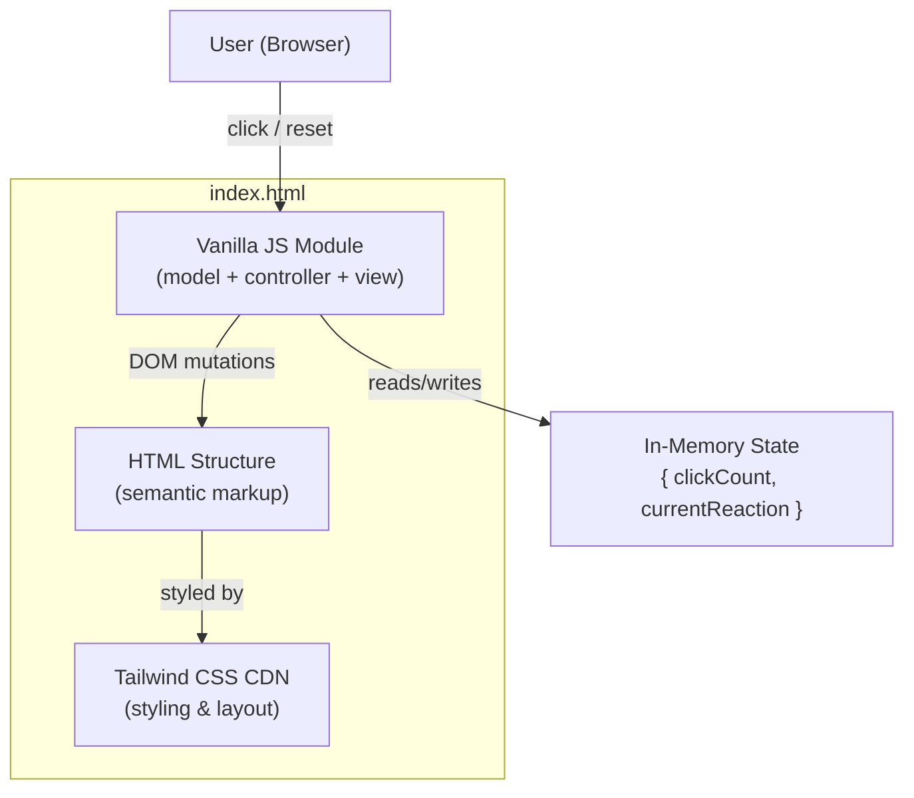

# Design Document

## Overview

Cat Clicker is a self-contained single-page application delivered as one `index.html` file. It presents a cat image that the user can click to trigger random reactions, tracks a running click count, and offers a reset control. The entire application — markup, styles (Tailwind CSS via CDN), and behavior (Vanilla JavaScript) — lives in a single file so it can be opened directly with the `file://` protocol in any modern browser without a build step.

The design follows a simple Model–View–Controller (MVC) separation entirely within one file:
- **Model**: plain JavaScript objects and variables holding application state.
- **View**: DOM manipulation functions that read state and update the page.
- **Controller**: event handlers that call model mutations and then re-render the view.

---

## Architecture



**Key architectural decisions:**

| Decision | Choice | Rationale |
|---|---|---|
| Delivery format | Single `index.html` | Requirement 7 — no build step, works via `file://` |
| Styling | Tailwind CSS CDN | Requirement 6.2 — utility-first, no local build |
| State management | Plain JS variables | Appropriate complexity level; no framework needed |
| Reaction selection | Fisher-Yates partial shuffle with last-reaction exclusion | Satisfies Requirement 2.4 — avoids immediate repeat when pool ≥ 2 |
| Animation | CSS keyframe classes toggled via JS | Requirement 3.3 — reusable without page reload |

---

## Components and Interfaces

### 1. HTML Structure

```
<body>
  ├── #app  (centered column wrapper, max-w-sm on md+)
  │    ├── #reaction-display   (text + emoji label)
  │    ├── #cat-image          (clickable )
  │    ├── #counter-display    (click count)
  │    └── #reset-button       (<button>)
```

Stacking behavior:
- Below 640 px (`< sm`): cat image and reaction display stack vertically, full width.
- 640 px and above (`sm+`): single column centered, max-width 480 px.

### 2. JavaScript Components

#### `State` (module-level variables)
```
clickCount        : number   – total clicks since last reset
currentReaction   : Reaction | null – the reaction currently shown
lastReactionIndex : number   – index of the most recently used reaction (-1 initially)
```

#### `reactionPool` (constant array)
Exactly 8+ `Reaction` objects defined at module scope. See Data Models.

#### `pickReaction(pool, lastIndex) → Reaction`
Selects a random reaction from `pool`, excluding the entry at `lastIndex` when `pool.length ≥ 2`. Returns the chosen `Reaction`.

#### `incrementCounter() → void`
Increments `clickCount` by 1, calls `pickReaction`, updates `currentReaction` and `lastReactionIndex`.

#### `resetState() → void`
Sets `clickCount` to 0, sets `currentReaction` to `null`, sets `lastReactionIndex` to -1.

#### `renderCounter() → void`
Writes `clickCount` (integer, no decimal) into `#counter-display`.

#### `renderReaction() → void`
Writes `currentReaction.emoji + " " + currentReaction.label` (or empty string when null) into `#reaction-display`. Removes any active animation class from `#cat-image`, then re-adds the reaction's `animationClass` on the next animation frame to restart the animation.

#### `renderReset() → void`
Clears `#reaction-display` and removes any active animation class from `#cat-image`.

#### `handleCatClick(event) → void`
Calls `incrementCounter()`, then `renderCounter()`, then `renderReaction()`.

#### `handleResetClick(event) → void`
Calls `resetState()`, then `renderCounter()`, then `renderReset()`.

### 3. Event Bindings (wired on `DOMContentLoaded`)

| Element | Event | Handler |
|---|---|---|
| `#cat-image` | `click` | `handleCatClick` |
| `#reset-button` | `click` | `handleResetClick` |

---

## Data Models

### `Reaction`

```typescript
{
  label         : string,  // short text description e.g. "Surprised"
  emoji         : string,  // single emoji character e.g. "😲"
  animationClass: string   // Tailwind-compatible CSS class name e.g. "anim-bounce"
}
```

### `reactionPool` — initial 8 entries

| # | label | emoji | animationClass |
|---|---|---|---|
| 0 | Surprised | 😲 | anim-bounce |
| 1 | Annoyed | 😾 | anim-shake |
| 2 | Sleepy | 😴 | anim-sway |
| 3 | Happy | 😺 | anim-spin |
| 4 | Scared | 🙀 | anim-wobble |
| 5 | Smug | 😏 | anim-pulse |
| 6 | Confused | 😕 | anim-tilt |
| 7 | Excited | 🐱 | anim-zoom |

### CSS Animation Classes

Each animation is a short `@keyframes` block (≤ 500 ms, `animation-fill-mode: none`) defined in a `<style>` tag inside `index.html`. Tailwind CDN does not provide these custom keyframes.

```css
/* Example */
@keyframes bounce-anim {
  0%, 100% { transform: translateY(0); }
  50%       { transform: translateY(-16px); }
}
.anim-bounce { animation: bounce-anim 0.4s ease; }
```

All eight animation classes follow the same pattern with distinct `@keyframes` names.

### Application State Shape

```javascript
let clickCount        = 0;
let currentReaction   = null;   // Reaction | null
let lastReactionIndex = -1;     // index into reactionPool
```

---

## Correctness Properties

> PBT applicability assessment: This feature is a simple UI-driven SPA. Most requirements concern rendering, layout, and CSS, which are not suitable for property-based testing. However, `pickReaction` is a **pure function** with clear input/output behavior and a universal invariant (no-repeat rule) that holds across all pool sizes and last-index values. That single piece of logic is the only part of the codebase where PBT provides meaningful value over example-based tests.

*A property is a characteristic or behavior that should hold true across all valid executions of a system — essentially, a formal statement about what the system should do. Properties serve as the bridge between human-readable specifications and machine-verifiable correctness guarantees.*

### Property 1: Reaction selection never repeats immediately when pool is large enough

*For any* reaction pool of size ≥ 2, calling `pickReaction(pool, lastIndex)` where `lastIndex` is a valid index in `pool` SHALL return a reaction whose index is different from `lastIndex`.

**Validates: Requirements 2.4**

### Property 2: Reaction selection always returns a valid pool member

*For any* non-empty reaction pool and any `lastIndex`, `pickReaction` SHALL return a value that is a member of that pool.

**Validates: Requirements 2.2, 3.1**

---

## Error Handling

| Scenario | Handling Strategy |
|---|---|
| Tailwind CDN unavailable (no network) | HTML structure remains functional; content is readable unstyled. Satisfies Requirement 7.4. |
| Cat image fails to load | `alt` attribute ("A cat") is displayed; click interaction still works because the click target is the `` element itself. |
| `pickReaction` called with empty pool | Guard clause returns `null`; `renderReaction` checks for null and clears the display. |
| Rapid repeated clicks | Each click is processed synchronously; no debouncing needed at this scale. Counter always reflects exact click count. |

---

## Testing Strategy

### Unit Tests

Because the app is a single HTML file with no module bundler, unit tests target the extracted pure functions in isolation using a test runner (e.g., Vitest with JSDOM, or plain Node).

Specific cases to cover:
- `pickReaction` returns a member of the pool.
- `pickReaction` excludes `lastIndex` when `pool.length ≥ 2`.
- `pickReaction` returns the only entry when `pool.length === 1` (even if it matches `lastIndex`).
- `incrementCounter` increases `clickCount` by exactly 1 per call.
- `resetState` sets `clickCount` to 0, `currentReaction` to null, `lastReactionIndex` to -1.
- `renderCounter` writes an integer string with no decimal point.
- `renderReaction` writes the correct label+emoji and toggles the animation class.
- `renderReset` clears the reaction display and removes animation classes.

### Property-Based Tests

Property-based testing applies only to `pickReaction`, which is a pure function. Use a library such as [fast-check](https://github.com/dubzzz/fast-check) (JavaScript).

Each test runs a minimum of **100 iterations**.

**Property 1 test** — No-repeat when pool ≥ 2:
```
Tag: Feature: cat-clicker, Property 1: Reaction selection never repeats immediately when pool is large enough
For any pool of size ≥ 2 and any valid lastIndex,
  pickReaction(pool, lastIndex).index !== lastIndex
```

**Property 2 test** — Result is always a pool member:
```
Tag: Feature: cat-clicker, Property 2: Reaction selection always returns a valid pool member
For any non-empty pool and any lastIndex,
  pool.includes(pickReaction(pool, lastIndex))
```

### Integration / Manual Tests

These are verified by opening `index.html` in a browser:
- Counter increments correctly on each click (Requirements 2.1, 4.1–4.3).
- Reaction display updates with emoji and label after each click (Requirement 2.3).
- CSS animation plays on the cat image after each click and does not persist between clicks (Requirements 3.3, 3.4).
- Reset button zeroes the counter, clears the reaction, and removes the animation (Requirements 5.1–5.4).
- Layout stacks vertically below 640 px and centers in a single column above (Requirements 6.1–6.4).
- App works via `file://` protocol with no console errors (Requirement 7.3).
- App renders unstyled but functional without network access (Requirement 7.4).
